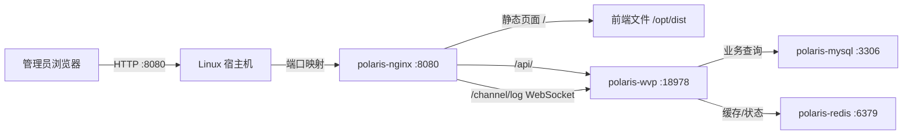
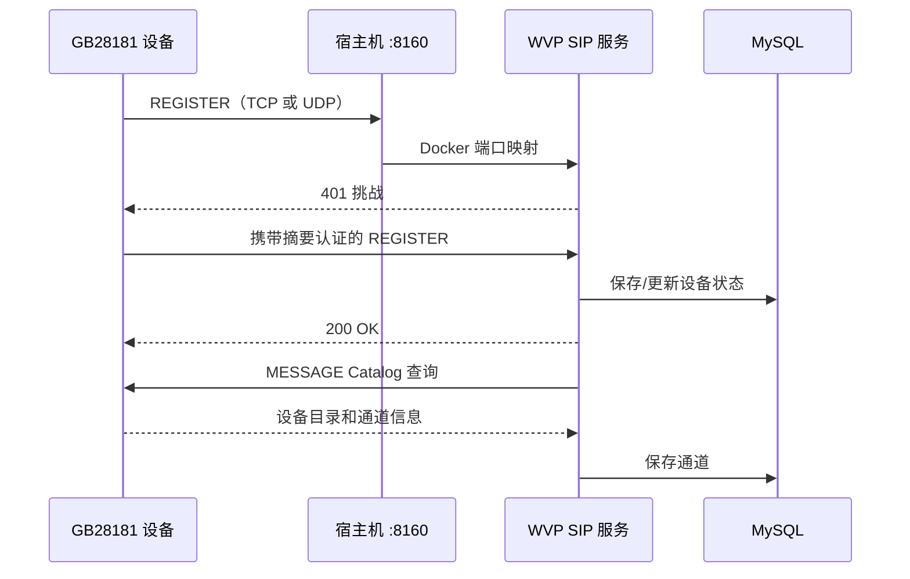
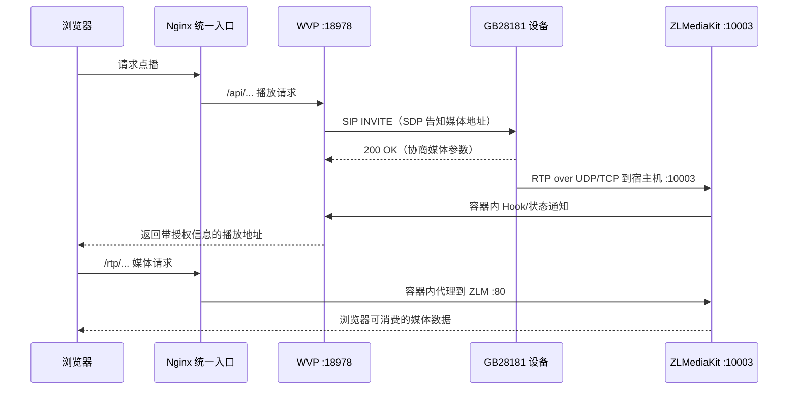

# 01 架构与基础概念

[返回手册首页](README.md) · [下一章：服务器准备](02-server-preparation.md)

这一章不要求你执行项目。读完后，你应该能回答三个问题：

1. WVP 和 ZLMediaKit 为什么必须同时存在；
2. 摄像机注册成功以后，视频数据实际发给了谁；
3. 为什么页面能打开，不代表视频端口一定畅通。

## 一句话理解两个核心项目

WVP 更像“视频平台的大脑和管理台”，ZLMediaKit 更像“媒体收发与协议转换引擎”。

WVP 负责用户、权限、设备、通道、GB28181 信令和播放调度，但不适合自己承担高吞吐媒体转发。ZLMediaKit 负责接收摄像机发来的 RTP、RTSP 或 RTMP 数据，并把媒体以合适的协议提供给浏览器或其他系统。

在当前 Compose 中，WVP 通过容器网络调用 ZLMediaKit；ZLMediaKit 的事件回调也通过容器网络通知 WVP。对这套部署而言，ZLMediaKit 不是可选的外挂。没有它，管理页面可能仍能启动，但收流、转协议和正常播放链路不完整。

## 五个服务各自做什么

| Compose 服务名 | 角色 | 对外端口 | 数据是否需要持久保存 |
|---|---|---|---|
| `polaris-wvp` | 登录、RBAC、设备/通道管理、SIP 信令、媒体调度、API | `8160/tcp+udp`（当前默认 SIP） | 配置、日志需要；业务数据主要在 MySQL |
| `polaris-media` | ZLMediaKit，接收 RTP/RTSP/RTMP，提供媒体输出 | `10003/tcp+udp`、`10002/tcp+udp`、`10001/tcp+udp` | 录像和媒体日志需要 |
| `polaris-mysql` | 用户、角色、部门、视频资源组、设备和业务数据 | 无宿主机映射 | 必须保存 |
| `polaris-redis` | 缓存、协同状态 | 无宿主机映射 | 当前启用 AOF，目录需要保存 |
| `polaris-nginx` | 管理页面、API、WebSocket、受保护媒体的内层统一入口 | `8080/tcp`（当前管理入口）；正式媒体由外层 `443` 回源 | 日志需要；前端在镜像内 |

“无宿主机映射”不是“没有端口”。例如 MySQL 在容器网络中仍监听 3306，只是外部网络不能通过宿主机 3306 直接访问它。

## 管理页面链路



这里的 `18978`、`3306` 和 `6379` 只在 `media-net` 容器网络里使用。浏览器不应直接访问它们。页面访问地址是：

```text
http://服务器地址:8080/
```

如果页面能打开但 API 返回 502，通常说明 Nginx 已经工作，而 WVP 还没准备好或正在重启。这个判断能把排查范围缩小一半。

## GB28181 注册与目录链路



设备注册只证明 SIP 信令基本连通。目录同步还要求设备能接收平台发出的 SIP 请求并正确返回 XML 内容。因此会出现下面几种不同状态：

- 设备不在线：先查地址、端口、协议、域、平台 ID、密码和防火墙；
- 设备在线但没有通道：先查 Catalog 查询、设备通道配置和 SIP 消息；
- 设备、通道都在线但不能播放：重点转向 INVITE、SDP、RTP 地址和媒体端口。

## 点播与媒体链路



图中的 Nginx 对容器内监听 8080。正式部署时，浏览器通常先访问外层 `HTTPS:443`，外层再回源这个 8080；只有第 07 章限定的可信局域网 HTTP 实验模式才直接使用标准 HTTP 80。当前票据不会把管理入口 `8080` 自动当成外部媒体端口。

最容易混淆的是：SIP 信令到 WVP，RTP 媒体到 ZLMediaKit。设备可能在 `8160/udp` 上成功注册，却因为 `10003/udp` 未映射或 SDP 中写错地址而没有画面。

当前部署把 GB28181 的单端口 RTP 收流配置为 `10003`。ZLMediaKit 配置里虽然还有 `30000-30500` 端口范围，但当前 WVP 配置使用单端口模式时，不应先入为主地把整段端口全部开放。以当前运行配置和实际日志为准。

## RTSP、RTMP 与 GB28181 的关系

设备统一管理不只一种接入办法：

- GB28181 设备通过 SIP 注册，由平台发起点播，媒体通常以 RTP 送到 ZLMediaKit；
- RTSP 拉流通常由平台或 ZLMediaKit 主动访问摄像机的 RTSP 地址；
- RTMP 推流由设备或编码器主动推送到 ZLMediaKit 的 RTMP 端口；
- HTTP 播放是浏览器消费媒体的一种方式，并不是摄像机注册协议。

当前端口默认值：

| 用途 | 端口 | 是否是 GB28181 基础接入必需 |
|---|---:|---|
| Web 管理/API 初始入口 | `8080/tcp` | 首次登录需要；生产部署完成 TLS 后不应公开绕过 |
| HTTPS 页面/API/WebSocket/受保护媒体 | `443/tcp` | 正式浏览器播放需要，由第 07 章的外层 TLS 入口提供 |
| GB28181 SIP | `8160/tcp`、`8160/udp` | 是，按设备选择的传输协议使用 |
| GB28181 RTP 单端口 | `10003/tcp`、`10003/udp` | 是，媒体传输使用哪种就放行哪种；新手可先两者都规划 |
| RTSP 收流 | `10002/tcp`、`10002/udp` | 不是，仅外部 RTSP 接入时需要 |
| RTMP 收流 | `10001/tcp`、`10001/udp` | 不是，仅外部 RTMP 推流时需要；RTMP 通常主要使用 TCP |

## 数据存在哪里

当前 Compose 使用宿主机 bind mount，也就是把项目目录中的真实文件夹挂进容器：

| 宿主机相对 `docker/` 的路径 | 主要内容 | 重要程度 |
|---|---|---|
| `volumes/mysql/data/` | MySQL 数据文件 | 最高，不能随意删除 |
| `volumes/redis/data/` | Redis AOF/数据 | 高 |
| `volumes/video/` | 录像文件 | 按业务保留 |
| `wvp/config/` | WVP 持久配置，如 JWK | 高 |
| `wvp/wvp/` | WVP 外部配置文件 | 高 |
| `media/config.ini` | ZLMediaKit 配置 | 高 |
| `logs/*/` | 各服务日志 | 排错重要，可按策略轮转 |

bind mount 和 Docker named volume 不一样。执行 `docker volume ls` 看不到这些目录，并不代表数据不存在。`docker compose down -v` 主要针对命名卷，但你仍然不应把任何带 `-v` 或清理含义的命令当作日常停止方式。

## 新手术语表

### 宿主机

实际运行 Docker 的 Linux 服务器。防火墙、安全组、磁盘和公网 IP 都属于宿主机或其外部网络。

### 镜像与容器

镜像是只读模板，容器是镜像启动后的实例。重新创建容器不一定丢数据，前提是重要数据正确挂载到了宿主机。

### Docker Compose

Compose 根据 `docker-compose.yml` 同时管理多个服务。本项目的命令应从 `docker/` 执行，这样 `.env` 和相对挂载路径才会按预期解析。

### 端口映射

例如 `8080:8080` 表示“宿主机 8080 转到容器 8080”。外部设备访问的是宿主机地址和左边的端口。

### SIP

GB28181 的信令协议，用于注册、保活、目录查询、点播邀请和控制。它负责协商，不承载主要视频数据。

### SDP

SIP 消息中的媒体描述，告诉设备视频应该发往哪个 IP、端口以及采用什么媒体参数。`SDP_IP` 写错时，注册可能正常，播放仍会失败。

### RTP

实际传送音视频数据的协议。GB28181 点播后，设备通常把 RTP 发给 ZLMediaKit。

### RTSP 与 RTMP

都是常见媒体接入协议。RTSP 常见于平台主动拉摄像机流；RTMP 常见于编码器主动推流。它们与 GB28181 注册不是一回事。

### NAT

路由器把内网地址转换为公网地址。经过 NAT 时，外部设备看到的地址和服务器自身网卡地址可能不同，所以还要配置端口转发，并在 SIP/SDP 中公布外部可达地址。

### 安全组与 Linux 防火墙

安全组是云平台外层规则，firewalld/UFW 是服务器内部规则。任意一层拒绝，数据都进不来。家用/园区路由器的端口映射是第三层控制。

### SELinux

CentOS/Rocky 上的强制访问控制。普通 Unix 文件权限正确时，SELinux 仍可能阻止容器访问挂载目录。正确做法是设置合适标签，而不是永久关闭 SELinux。

### 空数据目录

MySQL 官方镜像只有在 `/var/lib/mysql` 为空时才运行 `/docker-entrypoint-initdb.d/` 下的初始化 SQL。当前三个 SQL 文件因此只在全新数据库第一次初始化时按顺序执行。

## 这一章的自测

- [ ] 我知道页面/API 请求先进入 Nginx；
- [ ] 我知道 GB28181 SIP 到 WVP，RTP 到 ZLMediaKit；
- [ ] 我知道注册、目录和点播是三个独立阶段；
- [ ] 我知道 MySQL/Redis 内部端口不需要开放公网；
- [ ] 我知道重要数据位于 `docker/` 下的 bind mount 目录；
- [ ] 我不会用 HTTPS 配置代替 SIP/RTP 的 NAT 规划。

[返回手册首页](README.md) · [下一章：服务器准备](02-server-preparation.md)
