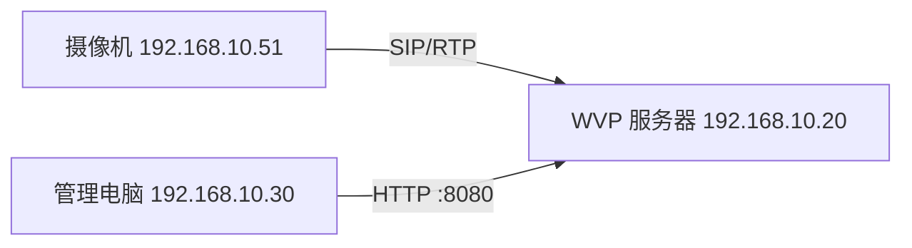
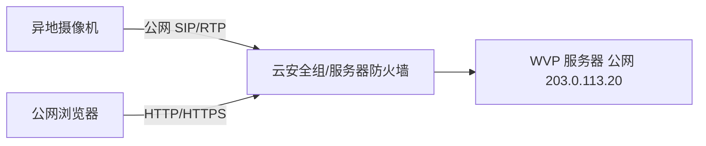
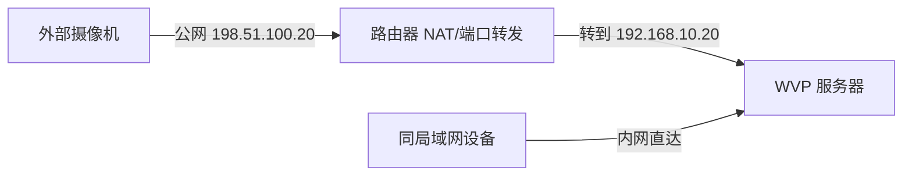

# 03 网络与端口

[上一章：服务器准备](02-server-preparation.md) · [返回首页](README.md) · [下一章：配置说明](04-configuration.md)

GB28181 部署是否成功，很大程度上取决于“设备从它所在的网络，究竟能访问服务器的哪个地址”。先确定拓扑，再填 `.env`，不要反过来。

## 1. 先填写部署参数表

把下面内容复制到你的运维记录中。暂时不知道的项目写“待确认”，不要猜。

| 参数 | 你的实际值 | 如何确认 |
|---|---|---|
| 服务器操作系统 |  | `cat /etc/os-release` |
| 服务器内网 IPv4 |  | `ip -4 address` |
| 服务器是否直接绑定公网 IP | 是 / 否 | 云控制台与 `ip -4 address` 对照 |
| 对外公网 IPv4 |  | 云控制台或路由器 WAN 页面 |
| 是否经过路由器 NAT | 是 / 否 | 公网 IP 是否直接出现在服务器网卡上 |
| 是否存在双层 NAT/CGNAT | 是 / 否 / 待确认 | 路由器 WAN 地址与运营商确认 |
| 摄像机所在网段 |  | 设备网络页面，如 `192.168.10.0/24` |
| 摄像机能否访问服务器内网 IP |  | 从同网电脑测试路由；最终看 SIP 包 |
| 管理电脑所在网络 | 内网 / 公网 / VPN |  |
| Web 端口 | 默认 `8080/tcp` | `docker/.env` |
| SIP 端口 | 默认 `8160/tcp+udp` | `docker/.env` |
| RTP 端口 | 默认 `10003/tcp+udp` | `docker/.env` |
| RTSP 收流端口 | 默认 `10002/tcp+udp` | 仅外部 RTSP 接入需要 |
| RTMP 收流端口 | 默认 `10001/tcp+udp` | 仅外部 RTMP 推流需要 |
| 域名 | 可选 | DNS 服务商 |
| TLS 入口 | 无 / 计划 80、443 | 当前 Compose 不自带 HTTPS |

## 2. 找到服务器的地址

### 2.1 查看网卡地址

```bash
ip -4 address show
ip route
```

常见内网地址范围：

- `10.0.0.0/8`；
- `172.16.0.0/12`；
- `192.168.0.0/16`。

`127.0.0.1` 是本机回环地址，只能指向“当前这台主机自己”。摄像机填写 `127.0.0.1` 时，访问的是摄像机自身，不是 WVP 服务器。所以默认 `.env` 中的三个 `127.0.0.1` 必须按拓扑修改。

### 2.2 公网 IP 是否真的在服务器上

直接公网场景中，云控制台显示的公网 IP 有时是云平台一对一 NAT 地址，并不会出现在 `ip address` 中。这并不一定是问题，但你必须按云厂商说明开放安全组，并使用云平台分配的公网地址作为外部公布地址。

家用或园区服务器通常只看到内网地址，公网地址在路由器 WAN 口。这就是路由器 NAT 场景。

## 3. 三种典型拓扑

### 3.1 场景 A：服务器和设备在同一局域网



建议：

- 使用第 07 章 HTTP 实验模式时 `Stream_IP=192.168.10.20`；使用 TLS 时改为证书覆盖且内网可解析的域名；
- `SDP_IP=192.168.10.20`；
- `SIP_ShowIP=192.168.10.20`；
- 摄像机平台地址填写 `192.168.10.20`；
- 不需要公网端口映射；
- 仍要检查服务器本机防火墙。

这个场景最适合第一次打通。先在局域网验证注册、目录、INVITE 和 RTP 收流；浏览器播放还需要按第 07 章选择“真实 443 TLS”或“可信局域网 HTTP 80”模式。底层链路确认后再引入公网/NAT，排错范围更小。

### 3.2 场景 B：服务器使用可直达公网 IP



建议：

- `Stream_IP` 使用证书覆盖、解析到该公网 IP 的域名；`SDP_IP`、`SIP_ShowIP` 使用外部设备实际可达的公网 IP；
- 云安全组和 Linux 防火墙都放行必需端口；
- 尽量按摄像机现场公网出口 IP 限制 SIP/RTP 来源；
- Web 管理界面优先通过 VPN、固定办公出口或 HTTPS 暴露；
- 确认云厂商是否额外限制 UDP、非标准端口或公网带宽。

文档中的 `203.0.113.20` 是保留示例地址，不能在真实部署中使用。

### 3.3 场景 C：服务器在路由器后面



建议：

- 外部摄像机的平台地址使用公网 IP `198.51.100.20`；
- `SDP_IP`、`SIP_ShowIP` 使用外部设备可达的公网地址；
- `Stream_IP` 取决于浏览器从哪里访问；正式 TLS 模式使用证书覆盖并解析到公网地址的域名；
- 路由器把相同的外部端口转发到 `192.168.10.20` 的相同内部端口，最容易维护；
- SIP 和 RTP 都要分别配置 TCP/UDP 规则；
- 路由器、防火墙、Compose 三处协议和端口必须一致。

如果同一批设备既有内网访问又有公网访问，而路由器不支持 NAT 回环，内网设备访问公网地址可能失败。可选方案是：让内网设备使用内网地址、外网设备使用公网地址并分开平台实例；使用支持 hairpin NAT 的网关；或通过 VPN/专线统一地址视角。单个 `.env` 无法魔法般同时发布两个互相不可达的地址。

## 4. 当前 Compose 的准确端口表

以下默认值来自当前 [`docker/.env`](../docker/.env) 和 [`docker/docker-compose.yml`](../docker/docker-compose.yml)。如果你改了 `.env`，所有表格都应以实际值为准。

| 宿主机端口 | 协议 | 到达服务 | 用途 | 纯 GB28181 是否需要 |
|---:|---|---|---|---|
| `8080` | TCP | `polaris-nginx:8080` | 页面、API、WebSocket 的初始管理入口；也是外层 TLS 的回源 | 首次管理需要，生产不应公开绕过 |
| `8160` | TCP | `polaris-wvp` | GB28181 SIP over TCP | 设备使用 TCP 时需要 |
| `8160` | UDP | `polaris-wvp` | GB28181 SIP over UDP | 设备使用 UDP 时需要 |
| `10003` | TCP | `polaris-media` | GB28181 RTP over TCP | 协商 TCP 媒体时需要 |
| `10003` | UDP | `polaris-media` | GB28181 RTP over UDP | 协商 UDP 媒体时需要 |
| `10002` | TCP/UDP | `polaris-media` | 外部 RTSP 接入 | 否 |
| `10001` | TCP/UDP | `polaris-media` | 外部 RTMP 接入 | 否；RTMP 通常走 TCP |
| `80` | TCP | 可选外部入口 | HTTP 跳转、ACME；或可信局域网 HTTP 实验 | 按部署模式 |
| `443` | TCP | 外部 TLS 入口 | HTTPS 页面、API、WebSocket、受保护媒体 | 正式浏览器播放需要；当前 Compose 未直接提供 |

以下端口只在容器网络内使用，不应作为公网开放清单：

| 容器端口 | 服务 | 原因 |
|---:|---|---|
| `3306` | MySQL | 仅 WVP 内部访问 |
| `6379` | Redis | 仅 WVP 内部访问 |
| `18978` | WVP HTTP | 由 Nginx 代理，不直接暴露 |
| `80` | ZLMediaKit HTTP | 由 Nginx 的 `/rtp/` 代理 |

当前 ZLMediaKit 配置包含 `30000-30500` RTP 端口范围，但当前 WVP Docker 配置使用单端口 RTP 模式。不要在没有运行证据的情况下把整段范围直接开放公网；如果以后改成多端口模式，再同步更新 Compose、云安全组、防火墙和 NAT。

`WebHttps=8081` 当前存在于 `.env`，但 Compose 没有发布它，不能因为变量存在就认为 `https://服务器:8081` 可用。ZLMediaKit 当前上报媒体 HTTPS 端口 443，播放票据优先使用 443；两者不是同一个配置来源，详见第 07 章。

## 5. 规划最小开放面

### 5.1 只接 GB28181 设备

首次启动、尚未配置 TLS 时通常至少规划：

- `8080/tcp`：仅给管理员访问，最好限制办公出口/VPN；
- `8160/tcp+udp`：设备注册和信令；
- `10003/tcp+udp`：媒体接收。

正式浏览器播放还要提供 `443/tcp` TLS 入口。完成后应把 8080 绑定本机或只允许 TLS 网关回源，不能继续作为公网旁路。可信局域网若暂时不用 TLS，必须按第 07 章同时使用宿主机 HTTP 80 和 ZLMediaKit `sslport=0`，不能只把 `.env` 的 `WebHttp` 改成任意端口。

如果所有设备明确只用 SIP/UDP 和 RTP/UDP，理论上只需 UDP 对应协议；但新手首次接入时可先规划 TCP+UDP，打通后再根据设备配置和抓包收紧。

### 5.2 还要接 RTSP/RTMP

- 外部系统主动连接平台 RTSP 入口时开放 `10002`；
- 编码器主动向平台推 RTMP 时开放 `10001`；
- 如果只是平台主动拉取摄像机内网 RTSP，重点是服务器能出站访问摄像机 RTSP 地址，不一定需要把平台 `10002` 暴露公网。

## 6. CentOS/Rocky 的 firewalld

先确认服务状态：

```bash
sudo systemctl enable --now firewalld
sudo firewall-cmd --state
sudo firewall-cmd --get-active-zones
```

以下示例按默认端口开放。执行前先确认活动网卡属于哪个 zone。示例使用 `public`，如果你的活动 zone 不同就替换。

```bash
sudo firewall-cmd --zone=public --permanent --add-port=8080/tcp
sudo firewall-cmd --zone=public --permanent --add-port=8160/tcp
sudo firewall-cmd --zone=public --permanent --add-port=8160/udp
sudo firewall-cmd --zone=public --permanent --add-port=10003/tcp
sudo firewall-cmd --zone=public --permanent --add-port=10003/udp
sudo firewall-cmd --reload
sudo firewall-cmd --zone=public --list-ports
```

只有确实使用 RTSP/RTMP 外部接入时再添加：

```bash
sudo firewall-cmd --zone=public --permanent --add-port=10002/tcp
sudo firewall-cmd --zone=public --permanent --add-port=10002/udp
sudo firewall-cmd --zone=public --permanent --add-port=10001/tcp
sudo firewall-cmd --zone=public --permanent --add-port=10001/udp
sudo firewall-cmd --reload
```

生产环境更推荐按设备现场公网出口 IP 写 rich rule，而不是允许全互联网访问 SIP/RTP。示例只允许 `203.0.113.45/32` 访问 SIP/UDP：

```bash
sudo firewall-cmd --zone=public --permanent \
  --add-rich-rule='rule family="ipv4" source address="203.0.113.45/32" port port="8160" protocol="udp" accept'
sudo firewall-cmd --reload
```

把示例 IP 换成真实固定出口。不要在保留全开放 `--add-port=8160/udp` 的同时以为 rich rule 已经限制来源；要在验证后删除宽泛规则。firewalld 用法参考：[官方开放端口说明](https://firewalld.org/documentation/howto/open-a-port-or-service.html)。

## 7. Ubuntu 的 UFW

先保证当前 SSH 端口不会被锁掉。如果 SSH 使用默认 22：

```bash
sudo ufw allow 22/tcp
sudo ufw allow 8080/tcp
sudo ufw allow 8160/tcp
sudo ufw allow 8160/udp
sudo ufw allow 10003/tcp
sudo ufw allow 10003/udp
sudo ufw enable
sudo ufw status verbose
```

如果 SSH 不是 22，先放行实际端口再启用 UFW。参考：[Ubuntu Server firewall 文档](https://documentation.ubuntu.com/server/how-to/security/firewalls/)。

重要限制：Docker 发布端口会经过 Docker 自己的 iptables/nftables 规则，可能绕过 UFW 的常规 INPUT 判断。Docker 官方明确提醒不能只凭 UFW 状态判断容器端口是否被限制。参考：[Docker packet filtering and firewalls](https://docs.docker.com/engine/network/packet-filtering-firewalls/)。

因此公网服务器还要使用云安全组限制来源；需要更精细的宿主机策略时，在理解 Docker `DOCKER-USER` 链后实施，并保留远程控制回退通道。

## 8. 云安全组

安全组位于数据包到达 Linux 之前。建议规则：

| 端口 | 协议 | 推荐来源 |
|---|---|---|
| SSH 实际端口 | TCP | 固定办公公网 IP 或堡垒机 |
| `8080` | TCP | 管理员/用户固定出口，或先接 VPN |
| `8160` | TCP/UDP | 摄像机现场公网出口 IP |
| `10003` | TCP/UDP | 摄像机现场公网出口 IP |
| `10001`、`10002` | 按需 | 对应推拉流系统的固定来源 |
| `80`、`443` | TCP | 仅启用域名/TLS 入口后按需求开放 |

不要创建“全部协议、全部端口、来源 `0.0.0.0/0`”的长期规则。临时排错放宽后必须记录并收回。

## 9. 路由器端口映射

NAT 场景建议外部端口与内部端口保持相同：

| 公网端口 | 协议 | 内网目标 | 内网端口 |
|---:|---|---|---:|
| `8080` | TCP | `192.168.10.20` | `8080` |
| `8160` | TCP | `192.168.10.20` | `8160` |
| `8160` | UDP | `192.168.10.20` | `8160` |
| `10003` | TCP | `192.168.10.20` | `10003` |
| `10003` | UDP | `192.168.10.20` | `10003` |

注意路由器界面中“TCP/UDP”有时会创建两条规则，有时只代表自动判断。保存后重新打开页面确认。

### 9.1 识别双层 NAT 和 CGNAT

如果路由器 WAN 地址落在以下范围，你通常没有直接公网 IPv4：

- `10.0.0.0/8`；
- `172.16.0.0/12`；
- `192.168.0.0/16`；
- `100.64.0.0/10`（运营商级 NAT 常见）。

此时只在自己的路由器做端口映射通常不够。需要运营商提供公网 IP、在上级网关继续做映射，或使用合规的 VPN/专线/内网穿透方案。不要把第三方隧道当作生产视频平台的默认安全方案。

## 10. 从正确位置验证端口

### 10.1 TCP

在另一台真实网络位置的机器上：

```bash
SERVER_HOST='REPLACE_WITH_REACHABLE_IP_OR_DOMAIN'
nc -vz "$SERVER_HOST" 8080
nc -vz "$SERVER_HOST" 8160
nc -vz "$SERVER_HOST" 10003
```

先替换变量值。TCP 成功表示能建立连接，但服务内容是否正确还要看应用日志。

### 10.2 UDP

`nc -zvu` 的“成功”经常只表示没有立即收到 ICMP 拒绝，不能证明 UDP 双向可用。最可靠的方法是在设备真实注册或点播时，在服务器观察数据包：

```bash
sudo tcpdump -ni any 'port 8160 or port 10003'
```

正常判断：

- 注册时应看到设备源 IP 到 `8160`；
- 点播后应看到设备源 IP 向 `10003` 连续发送 RTP；
- 只有发入没有返回，查服务器出站路由、防火墙和 SIP 公布地址；
- 完全没包，查设备配置、安全组、路由器映射和运营商网络。

抓包可能包含设备 ID、IP 和信令内容，分享前必须脱敏。排错完成后按 `Ctrl+C` 停止，不要长期无边界抓包。

## 11. 网络带宽方向

设备把视频发到服务器，消耗服务器入站带宽；用户从服务器播放，消耗服务器出站带宽。如果 20 路各 4 Mbps 同时上行并被 20 个用户分别观看，不能只按 80 Mbps 计算总网络，还要考虑对外播放的叠加、协议开销和峰值。

云服务器还要确认公网带宽是按入/出方向如何计费和限速。录像写本地磁盘不等于不占设备到服务器的入站带宽。

## 12. 本章验收

- [ ] 已明确局域网、直接公网或 NAT 场景；
- [ ] 已记录服务器内网和外部可达地址；
- [ ] 已确认是否存在 CGNAT/双层 NAT；
- [ ] 只规划了当前实际需要的端口；
- [ ] 安全组、Linux 防火墙和路由器映射三层都已核对；
- [ ] 知道 UFW 不能单独证明 Docker 发布端口已受限；
- [ ] 没有把 MySQL、Redis、WVP 18978 或 ZLM HTTP 80 暴露公网；
- [ ] 知道 TCP 探测不能证明 UDP 可用；
- [ ] 已选定下一章要填入 `Stream_IP`、`SDP_IP`、`SIP_ShowIP` 的地址。

[上一章：服务器准备](02-server-preparation.md) · [返回首页](README.md) · [下一章：配置说明](04-configuration.md)
