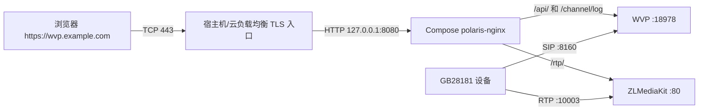

# 07 域名、HTTPS 与 NAT

[上一章：GB28181 设备接入](06-gb28181-device-access.md) · [返回首页](README.md) · [下一章：日常运维与备份](08-operations-and-backup.md)

这一章是进阶部署。基础 Compose 当前只发布 HTTP `8080`，没有自动申请证书，也没有发布 `.env` 中的 `WebHttps`。下面的目标是在现有 Nginx 之前增加一个受维护的 TLS 入口，同时保持 SIP/RTP 网络独立。

## 1. 先划清三个边界

### 1.1 域名只解决“用名字找到地址”

域名把 `wvp.example.com` 解析到公网 IP。它不会自动开放端口、配置 NAT 或让摄像机接受一个原本不可达的地址。

### 1.2 HTTPS 只保护 Web 链路

HTTPS 保护浏览器到 Web 入口的页面、API、WebSocket 和经反向代理传输的媒体。GB28181 的 SIP `8160` 和 RTP `10003` 仍是独立协议、独立端口。

### 1.3 NAT 需要双向可达

路由器映射只把外部包送进服务器。WVP 在 SIP/SDP 中公布的地址也必须是设备能访问的公网地址，返回路径还要正确。

## 2. 中国大陆公网合规提醒

如果服务通过中国大陆境内服务器向互联网提供信息服务，应在公开上线前向你的接入服务商确认 ICP 备案、公安备案和行业专项要求。工信部现行《非经营性互联网信息服务备案管理办法》规定，在境内通过互联网域名或 IP 地址提供非经营性互联网信息服务应依法履行备案，并要求主页标明备案编号等信息。参考：[工信部 2024 修订办法](https://www.miit.gov.cn/gyhxxhb/jgsj/cyzcyfgs/bmgz/xxtxl/art/2024/art_84a0cfa0ebd049bbbe751dca9a008e56.html)。

纯内网系统、专线系统、经营性服务以及涉及视听、公安、保密等场景的具体要求不同。本手册不是法律意见；以接入商、所在地通信管理局和组织合规人员的书面结论为准。

## 3. 配置域名

### 3.1 创建 DNS 记录

在域名 DNS 服务商中创建：

```text
类型：A
主机记录：wvp
记录值：你的公网 IPv4
```

最终域名类似：

```text
wvp.example.com
```

不要原样使用 `example.com`。

### 3.2 验证解析

从服务器和外部电脑分别执行：

```bash
getent hosts wvp.example.com
```

如果安装了 `dig`：

```bash
dig +short A wvp.example.com
```

结果应是你计划的公网地址。服务器解析正确、外部解析错误时，可能是 DNS 缓存、记录线路或分地域解析问题。

### 3.3 内外网使用同一域名

NAT 路由器不支持 hairpin NAT 时，内网访问公网解析可能失败。可在企业 DNS 中做 split DNS：外网把域名解析到公网 IP，内网把同一域名解析到服务器内网 IP。证书仍验证域名，不受内外地址不同影响。

不要在每台终端随意改 `/etc/hosts` 作为长期方案；那会造成证书续期、迁移和故障切换难以维护。

## 4. 推荐的 TLS 架构



TLS 入口可以是：

- 云负载均衡/应用网关，证书由云平台托管；
- 宿主机 Nginx + Certbot；
- 组织已有的统一反向代理或 WAF。

本手册不建议直接把 WVP 内部 18978 或 ZLMediaKit HTTP 80 暴露给证书工具。

## 5. 让 WVP 正确生成并交付媒体地址

这一节必须按当前代码理解，不能只凭变量名猜配置关系。

WVP 在 ZLMediaKit 上线后读取它实际报告的 HTTP/HTTPS 端口。当前 [`docker/media/config.ini`](../docker/media/config.ini) 的 `[http]` 配置是 `port=80`、`sslport=443`，因此播放票据会优先生成：

```text
https://Stream_IP:443/rtp/...
wss://Stream_IP:443/rtp/...
```

各项来源如下：

| 地址部分 | 当前真实来源 | 作用 |
|---|---|---|
| 主机名 | `.env` 的 `Stream_IP` | 告诉观看端访问哪个主机 |
| HTTP 端口 | ZLMediaKit `[http] port` | 当前为 80 |
| HTTPS 端口 | ZLMediaKit `[http] sslport` | 当前为 443，票据优先选用 |
| `WebHttp` | Compose 的宿主机端口映射 | 当前只负责页面/API 的 8080 管理入口 |
| `WebHttps` | 当前 Compose 未消费的预留变量 | 不会创建监听、证书或代理 |

`docker-compose.yml` 中被注释的 `MediaHttps` 只会传给 WVP 配置里的 `media.flv-ssl-port`/`media.ws-flv-ssl-port`；当前 ZLMediaKit 播放 URL 的生成路径使用媒体节点实际上报的 `http.sslport`，不使用这两个值。因此：**不要取消 `MediaHttps` 注释来“开启 HTTPS”**，那不会替代真正的 443 TLS 入口。

### 5.1 推荐模式：域名 + 真实 443 TLS 入口

执行目录：Compose 目录。

```bash
cd /opt/wvp-GB28181-pro/docker
cp -a .env ".env.before-https.$(date +%Y%m%d-%H%M%S)"
```

按实际域名修改：

```dotenv
WebHttp=8080
WebHttps=443
Stream_IP=wvp.example.com
```

`WebHttps=443` 在当前 Compose 中只是把部署规划记录完整，不会自动生效。真正必须完成的是：让域名的 TCP 443 到达本章后面的 TLS 入口，并由该入口把页面、API、WebSocket 和 `/rtp/` 全部转给内层 `polaris-nginx:8080`。

`SDP_IP` 和 `SIP_ShowIP` 不要因为配置域名就机械改动。它们仍按 GB28181 设备可达的公网/内网 IP 规划。

保持 [`docker/media/config.ini`](../docker/media/config.ini) 的 HTTP 段为：

```ini
[http]
port=80
sslport=443
```

这里的 `sslport=443` 用于让 WVP 知道外部受保护媒体入口应为 443；TLS 证书由外层入口终止，外层再用 HTTP 回源内层 Nginx。不要把 ZLMediaKit 容器的 443 直接发布到公网。

可在修改前只读核对：

```bash
sed -n '/^\[http\]/,/^\[/p' media/config.ini
grep -E '^(WebHttp|WebHttps|Stream_IP)=' .env
grep -n 'MediaHttps' docker-compose.yml
```

最后一条应仍看到注释状态。

### 5.2 TLS 验证后把 8080 限制到本机

等 443 完整验证成功后，可把 `polaris-nginx` 的端口映射从：

```yaml
- "${WebHttp:-8080}:8080"
```

改为：

```yaml
- "127.0.0.1:${WebHttp:-8080}:8080"
```

这样公网不能直接绕过 TLS 访问 8080，而宿主机 Nginx 仍能代理。如果 TLS 入口在另一台服务器或云负载均衡，不能绑定 127.0.0.1；应改为私网可达地址并用安全组限制来源。

每次修改后：

```bash
docker compose config --quiet
docker compose up -d --force-recreate polaris-wvp polaris-nginx
docker compose ps
```

不要在 443 尚未可用时先封死唯一的 8080 管理入口。

### 5.3 仅限可信局域网的 HTTP 实验模式

如果你只是第一次在隔离、可信的局域网中学习，暂时没有域名和证书，可以让播放票据退回标准 HTTP 80。这个模式会明文传输登录和播放凭证，**严禁用于公网、访客网络或生产环境**。

先确认宿主机 80 未被占用：

```bash
sudo ss -lntp | grep -E ':80\b' || true
```

备份配置：

```bash
cd /opt/wvp-GB28181-pro/docker
cp -a .env ".env.before-lan-http.$(date +%Y%m%d-%H%M%S)"
cp -a media/config.ini "media/config.ini.before-lan-http.$(date +%Y%m%d-%H%M%S)"
```

`.env` 使用：

```dotenv
WebHttp=80
Stream_IP=192.168.10.20
```

把 `media/config.ini` 的 `[http]` 段改为：

```ini
[http]
port=80
sslport=0
```

然后只重建受影响服务：

```bash
docker compose config --quiet
docker compose up -d --force-recreate polaris-media polaris-wvp polaris-nginx
docker compose ps
```

预期播放票据地址形如：

```text
http://192.168.10.20:80/rtp/...
ws://192.168.10.20:80/rtp/...
```

不要把 `WebHttp` 随意改成 8080 后期待播放地址也自动变成 8080：当前播放地址的 HTTP 端口来自 ZLMediaKit 上报的内部 `port=80`，而不是 `WebHttp`。如果宿主机 80 无法使用，优先采用本章推荐的 443 TLS 模式；要支持其他外部媒体端口，需要额外实现并验证“内部监听端口”和“外部公布端口”分离，已经超出单纯部署配置。

从实验模式切换到正式 HTTPS 时，恢复 `sslport=443`，把 `WebHttp` 恢复为计划的管理端口、`Stream_IP` 改为域名，重建上述三个服务，再完整执行本章的 TLS 验收。

## 6. 方案 A：云负载均衡或应用网关

这是新手在云环境中较稳妥的方式：

1. 在云证书服务中申请/上传域名证书；
2. 创建 443 HTTPS 监听；
3. 后端指向 WVP 服务器私网 `8080/tcp`；
4. 开启 WebSocket；
5. 后端协议使用 HTTP；
6. 空闲超时设置要覆盖长时间媒体/WebSocket；
7. 转发 `Host`、`X-Forwarded-For`、`X-Forwarded-Proto`；
8. 在边缘明确拒绝 `/index/hook/`；
9. 安全组只允许负载均衡到服务器 8080；
10. 证书续期由云平台托管，但仍要监控到期时间。

云平台产品名称和控制台会变化，以账号所在云的官方文档为准。媒体长连接和 WebSocket 功能不能只靠“HTTPS 监听创建成功”推断，需要实际播放和日志连接验证。

## 7. 方案 B：宿主机 Nginx + Certbot

### 7.1 安装宿主机 Nginx

CentOS/Rocky：

```bash
sudo dnf install -y nginx
sudo systemctl enable --now nginx
```

Ubuntu：

```bash
sudo apt update
sudo apt install -y nginx
sudo systemctl enable --now nginx
```

确认 80/443 没有被其他程序占用：

```bash
sudo ss -lntp | grep -E ':(80|443)\b' || true
```

### 7.2 建立 HTTP 反向代理

先备份已有 Nginx 配置。不要覆盖服务器上其他站点。

创建 `/etc/nginx/conf.d/wvp.conf`，把域名替换为实际值：

```nginx
map $http_upgrade $connection_upgrade {
    default upgrade;
    ''      close;
}

server {
    listen 80;
    server_name wvp.example.com;

    location ^~ /index/hook/ {
        access_log off;
        return 404;
    }

    location / {
        proxy_pass http://127.0.0.1:8080;
        proxy_http_version 1.1;
        proxy_set_header Host $host;
        proxy_set_header X-Real-IP $remote_addr;
        proxy_set_header X-Forwarded-For $proxy_add_x_forwarded_for;
        proxy_set_header X-Forwarded-Proto $scheme;
        proxy_set_header Upgrade $http_upgrade;
        proxy_set_header Connection $connection_upgrade;
        proxy_set_header Sec-WebSocket-Protocol $http_sec_websocket_protocol;
        proxy_connect_timeout 60s;
        proxy_read_timeout 3600s;
        proxy_send_timeout 60s;
        client_max_body_size 100m;
    }
}
```

为什么保留这些设置：

- `/channel/log` 是 WebSocket，需要显式传 `Upgrade` 和 `Connection`；
- `/rtp/` 可能是长时间媒体连接，需要较长 read timeout；
- `/index/hook/` 含媒体节点回调身份信息，只应走 Compose 内部网络；
- `X-Forwarded-Proto` 让后端知道外部使用 HTTPS；
- 外层只代理到内层 Nginx，不直接访问 WVP/ZLM 内部端口。

WebSocket 代理要求参考：[Nginx WebSocket proxying](https://nginx.org/en/docs/http/websocket.html)。普通反向代理参考：[NGINX reverse proxy](https://docs.nginx.com/nginx/admin-guide/web-server/reverse-proxy/)。

检查并加载：

```bash
sudo nginx -t
sudo systemctl reload nginx
curl -I http://wvp.example.com/
```

`nginx -t` 必须成功。外部网络访问 `http://域名/` 也应到达 WVP 页面。

CentOS/Rocky 在 SELinux enforcing 下，如果 Nginx 错误日志明确显示无法连接 `127.0.0.1:8080`，先用 `ausearch -m AVC -ts recent` 确认证据，再允许 Web 服务建立后端网络连接：

```bash
sudo setsebool -P httpd_can_network_connect 1
sudo systemctl reload nginx
```

这是为反向代理授予受控能力，不需要也不应永久关闭 SELinux。

### 7.3 开放 80/443

firewalld：

```bash
sudo firewall-cmd --zone=public --permanent --add-service=http
sudo firewall-cmd --zone=public --permanent --add-service=https
sudo firewall-cmd --reload
```

UFW：

```bash
sudo ufw allow 80/tcp
sudo ufw allow 443/tcp
sudo ufw status
```

云安全组/NAT 同样开放或转发 80/443。HTTP-01 证书验证只能从公网访问 TCP 80；不能把外部 8080 当作 HTTP-01 的替代端口。参考：[Let's Encrypt challenge types](https://letsencrypt.org/docs/challenge-types/)。

### 7.4 安装 Certbot

Certbot 官方当前优先推荐 snap 安装，并提供交互式系统选择说明：[Certbot Nginx instructions](https://certbot.eff.org/instructions?ws=nginx&os=snap)。中国大陆服务器访问 Snap Store 可能受线路影响；如果失败，可以使用发行版官方仓库提供的 `certbot`/Nginx 插件，或使用云厂商托管证书，但不要执行来源不明的一键证书脚本。

Ubuntu 使用 snap 的常见路径：

```bash
sudo apt update
sudo apt install -y snapd
sudo snap install core
sudo snap refresh core
sudo snap install --classic certbot
sudo ln -s /snap/bin/certbot /usr/local/bin/certbot
certbot --version
```

CentOS/Rocky 的 snapd 安装方式取决于版本和已启用仓库。按 Snapcraft/发行版当前官方说明安装并启用 `snapd.socket` 后，再执行 Certbot 官方命令。若使用 EPEL 包，则记录包版本和更新责任人。

不要同时保留 apt/dnf 版和 snap 版 Certbot，避免实际运行的二进制和续期 timer 不是同一个。

### 7.5 申请并安装证书

确保：DNS 已指向服务器、80 从公网可达、Nginx HTTP 配置正常。

```bash
sudo certbot --nginx -d wvp.example.com
```

按提示填写通知邮箱、同意条款并选择 HTTP 跳转 HTTPS。Certbot 会修改 Nginx 配置；完成后务必自己检查：

```bash
sudo nginx -t
sudo systemctl reload nginx
curl -I https://wvp.example.com/
```

如果端口 80 无法开放，可使用 DNS-01。它通过 `_acme-challenge` TXT 记录验证，并适合通配符证书，但应使用 DNS 服务商 API 自动续期；手工 DNS 验证通常无法自动续期。DNS API 密钥必须限制最小权限并以 600 权限保存。

### 7.6 验证自动续期

```bash
sudo certbot renew --dry-run
systemctl list-timers | grep -i certbot || true
sudo certbot certificates
```

`renew --dry-run` 成功才算续期链路完成。还要设置证书到期监控，不能只相信 timer 存在。

Certbot 参考：[官方使用文档](https://eff-certbot.readthedocs.io/en/stable/using.html)。

## 8. HTTPS 完整验证

### 8.1 页面和 API

- 浏览器地址栏证书有效，域名匹配；
- HTTP 自动跳转到 HTTPS；
- 登录、退出、修改密码、动态菜单正常；
- 浏览器开发者工具没有 mixed content。

### 8.2 WebSocket

打开需要实时日志的页面，浏览器网络面板中 `/channel/log` 应升级为 WebSocket。502/400 时依次检查外层 Nginx、内层 Nginx、一次性 ticket 和 `Sec-WebSocket-Protocol` 头。

### 8.3 媒体

点播后，平台返回的临时媒体地址应优先为：

```text
https://wvp.example.com:443/...
wss://wvp.example.com:443/...
```

而不是 `http://...:8080`、`127.0.0.1` 或容器名。浏览器能播放，并且票据过期后旧地址不能长期复用。

### 8.4 Hook 不能公开

```bash
curl -i https://wvp.example.com/index/hook/on_play
```

预期为 404。外层和内层代理都不应把 Hook 回调转发到公网 WVP。

### 8.5 8080 不可绕过

如果已将 Compose 绑定为 `127.0.0.1:8080`，从外部执行：

```bash
nc -vz wvp.example.com 8080
```

应无法建立公网连接；服务器本机 `curl http://127.0.0.1:8080/` 仍成功。

## 9. NAT 端口映射总表

使用宿主机 Nginx 后，典型映射：

| 外部端口 | 协议 | 内网服务器端口 | 用途 |
|---:|---|---:|---|
| `80` | TCP | `80` | HTTP 跳转、ACME HTTP-01 |
| `443` | TCP | `443` | HTTPS/WebSocket/受保护媒体 |
| `8160` | TCP/UDP | `8160` | GB28181 SIP |
| `10003` | TCP/UDP | `10003` | GB28181 RTP |
| `10001` | 按需 | `10001` | RTMP 接入 |
| `10002` | 按需 | `10002` | RTSP 接入 |

`8080` 不再需要公网映射。MySQL 3306、Redis 6379、WVP 18978 和 ZLM HTTP 80 仍不映射公网。

## 10. NAT 特殊问题

### 10.1 双层 NAT

光猫路由一层、企业路由再一层时，两层都需要映射，或把上层改桥接/DMZ 到受控下层。只配置最靠近服务器的一层不会生效。

### 10.2 CGNAT

路由器 WAN 地址位于 `100.64.0.0/10` 或私网范围，通常说明运营商没有分配独立公网 IPv4。需要申请公网 IP、使用 IPv6（前提是整条链路和设备支持并正确防护）、VPN/专线或合规隧道。

### 10.3 NAT 回环

内网设备用公网地址访问同一内网服务器失败，而外部正常，通常是路由器不支持 hairpin NAT。使用 split DNS 或内外地址分流，不要把 `SDP_IP` 在内外地址之间来回改导致另一批设备失效。

### 10.4 动态公网 IP

DDNS 能更新域名，但有些摄像机在注册时只解析一次域名，RTP/SDP 也可能使用缓存地址。公网 IP变化后要验证设备重新解析、重新注册和点播。生产平台优先使用固定公网 IP。

## 11. 本章验收

- [ ] 域名 A 记录从内外网络解析正确；
- [ ] 已确认中国大陆公网服务的备案/合规责任；
- [ ] TLS 入口只代理到内层 Nginx，不直连 WVP/ZLM 内部端口；
- [ ] ZLMediaKit 上报 `http.sslport=443`，`Stream_IP` 为实际域名；
- [ ] 页面、API、WebSocket 和媒体都通过 HTTPS 验证；
- [ ] `/index/hook/` 从公网返回 404；
- [ ] Certbot/云证书续期已实际验证并监控；
- [ ] 公网不能绕过 HTTPS 直接访问 8080；
- [ ] SIP/RTP 端口仍独立映射并验证；
- [ ] 已处理双层 NAT、CGNAT 和 NAT 回环中的实际问题。

[上一章：GB28181 设备接入](06-gb28181-device-access.md) · [返回首页](README.md) · [下一章：日常运维与备份](08-operations-and-backup.md)
